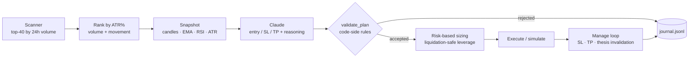

# AI Scalping Bot — Bitget USDT-M Futures


A multi-pair crypto futures scalping bot where an LLM (Claude) writes the trade plan
and deterministic code decides whether that plan is allowed to exist. Built together
with a backtesting harness whose main job is to **disprove** strategies before they
cost real money.

> **Research project, not financial advice.** The bot has only ever run in dry-run
> mode and the live-order path has never been executed. Development is currently
> **paused** after the experiments below. Results are negative, and they are reported
> as such.

---

## How it works



**The AI proposes; the code disposes.** Claude never sizes a position or picks
leverage. Every plan passes through hard checks before anything is placed:

| Check | Rule |
|---|---|
| Stop-loss width | ≥ 2× ATR of that pair, ≥ 0.7%, ≤ 3.5% — too-tight plans are rejected, not silently widened |
| Net risk:reward | ≥ 1.3 **after** maker/taker fees |
| Position size | `notional = risk% × balance / (SL% + worst-case fees)` — wider stop → smaller position |
| Leverage | highest value that keeps SL within 50% of the liquidation distance |
| Portfolio risk | max 3 concurrent positions, total open risk ≤ 1.5% of balance |
| AI health | 5 consecutive AI errors trip a circuit breaker and halt the bot |

## Engineering highlights

- **Pessimistic simulation.** Early dry runs looked far better than reality because
  limit orders were assumed to fill, PnL was taken at check time instead of at the
  SL/TP level, and fees were ignored. All fixed: limit fills need a real price touch,
  exits are clamped to the level, maker/taker fees are modeled separately, and only
  candles formed *after* order placement count.
- **Backtest harness with a control group.** `backtest.py` replays historical candles
  through the same rules using a mechanical EMA-pullback planner instead of the AI,
  giving the AI something to beat.
- **Out-of-sample validation.** `validate` tunes on the first 70% of data and scores
  on the last 30%. Every parameter that improved TRAIN got worse on TEST.
- **Lookahead sanity check.** On synthetic random-walk data the backtest loses roughly
  the fee amount (profit factor < 1). A backtest that profits on random data is lying;
  this is enforced in CI (`tests/test_backtest_sanity.py`).
- **Single source of truth.** Indicators and fee/leverage math live in `core/` and are
  shared by the bot and the backtest. Extracting them exposed a real bug: the two
  files used different ATR formulas (Wilder vs simple average) while the comments
  claimed they were identical.
- **Structured journal.** Every decision, rejection, fill, and close is written as
  JSON lines; `scripts/report.py` turns it into win rate, breakeven rate, margin, and
  profit factor.

## Results (honest)

Metrics used instead of raw profit, because net PnL is meaningless on small samples:

- **breakeven win rate** = avg loss / (avg loss + avg win)
- **margin** = win rate − breakeven win rate → positive means an edge exists
- **profit factor** = gross wins / gross losses

| Run | Trades | Win rate | Breakeven | Margin | Profit factor |
|---|---:|---:|---:|---:|---:|
| Control group (rule-based, no AI), full backtest, 10 pairs × 30 days | 110 | 20.0% | 40.4% | −20.4 | 0.37 |
| Control group, out-of-sample (last 30%) | — | — | — | ≈ −26 | ≈ 0.25 |
| **AI planner, live-data dry run** | **12** | **25.0%** | **38.0%** | **−13.0** | **0.54** |

The backtest's default config (limit entry, SL 1.2× ATR) is the one the original
experiments used, so the control rows are not a perfectly like-for-like comparison with
the live config (market entry, SL 2× ATR); `python backtest.py validate` reruns any of it.

The AI beat the mechanical control group on both margin and profit factor, but it is
still losing (≈ −3.7R over 12 trades) and **12 trades is far too few to conclude
anything**. The project was paused at this point; the next step, if resumed, is to
collect 40–50 trades with the config untouched before changing a single parameter.

### What the data ruled out

1. EMA20/50 on 5m carries no directional information — both the signal and its
   inverse lose (110 trades, z ≈ −4.2).
2. Parameter tuning does not create an edge; in-sample "improvements" vanish out of
   sample.
3. Limit-at-pullback vs market entry: an apparent advantage in-sample, no difference
   out of sample.
4. A smarter model is not the fix — the bottleneck is the information going in, not
   the reasoning.

## Project structure

```
├── bot_scalp.py            # main bot: scanner, AI planner, validation, execution, manage loop
├── backtest.py             # fetch / run / atr / sweep / validate
├── teacher_bot.py          # CLI: distill books & chart screenshots into knowledge.md
├── core/
│   ├── indicators.py       # EMA, RSI, ATR (Wilder & SMA)
│   ├── fees.py             # maker/taker fees, net R:R, safe leverage, risk sizing
│   └── metrics.py          # win rate, breakeven, margin, profit factor, drawdown
├── scripts/
│   ├── report.py           # performance report from the journal
│   └── check_connections.py
├── tests/                  # pytest, run in GitHub Actions
├── legacy/bot_v1.py        # first version (BTC only, fixed % SL/TP), kept for comparison
└── CLAUDE.md               # project context & guardrails for AI-assisted development
```

## Quick start

```bash
git clone https://github.com/zVertiXx2/autotrade_bot.git
cd autotrade_bot
python -m venv venv && venv\Scripts\activate      # Windows (Linux/macOS: source venv/bin/activate)
pip install -r requirements-dev.txt

cp .env.example .env                               # fill in Bitget + Anthropic keys
python scripts/check_connections.py

python backtest.py fetch                           # download 30 days of 5m candles
python backtest.py run
python backtest.py validate SL_ATR_MULT

python bot_scalp.py                                # DRY_RUN = True by default
python scripts/report.py --by-symbol

python -m pytest -q
```

Use a Bitget API key **with withdrawals disabled** and an IP whitelist where possible.

## If development resumes

- [ ] Reach 40–50 dry-run trades, then compare against the control group with a proper
      significance test
- [ ] Add genuinely new perp-specific inputs: funding rate, open interest, long/short
      ratio, liquidations
- [ ] Test a 1h timeframe, where fees are small relative to the move
- [ ] Wire `knowledge.md` from the Teacher Bot into the planning prompt (currently
      disconnected, by design, until there is a baseline to compare against)
- [ ] Per-setup feedback instead of per-pair: the scanner rotates pairs, so 68% of
      plan requests currently see no history
- [ ] VPS deployment with a dashboard

## Tech stack

Python · [ccxt](https://github.com/ccxt/ccxt) · [Anthropic API](https://docs.claude.com)
(Claude Sonnet) · pytest · GitHub Actions

## License

MIT — see [LICENSE](LICENSE).
